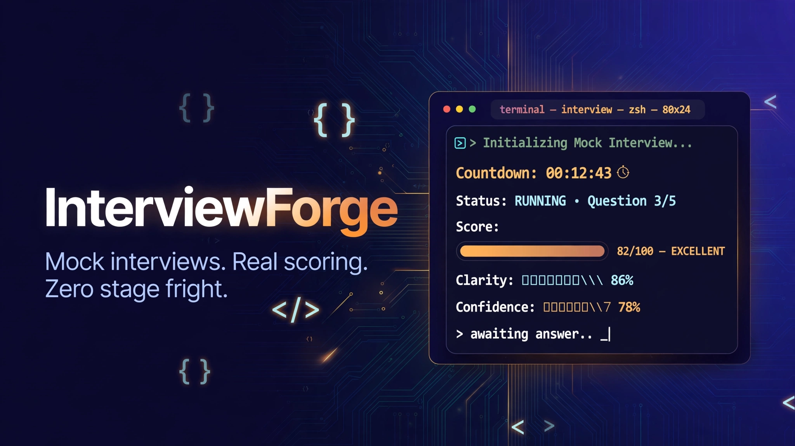
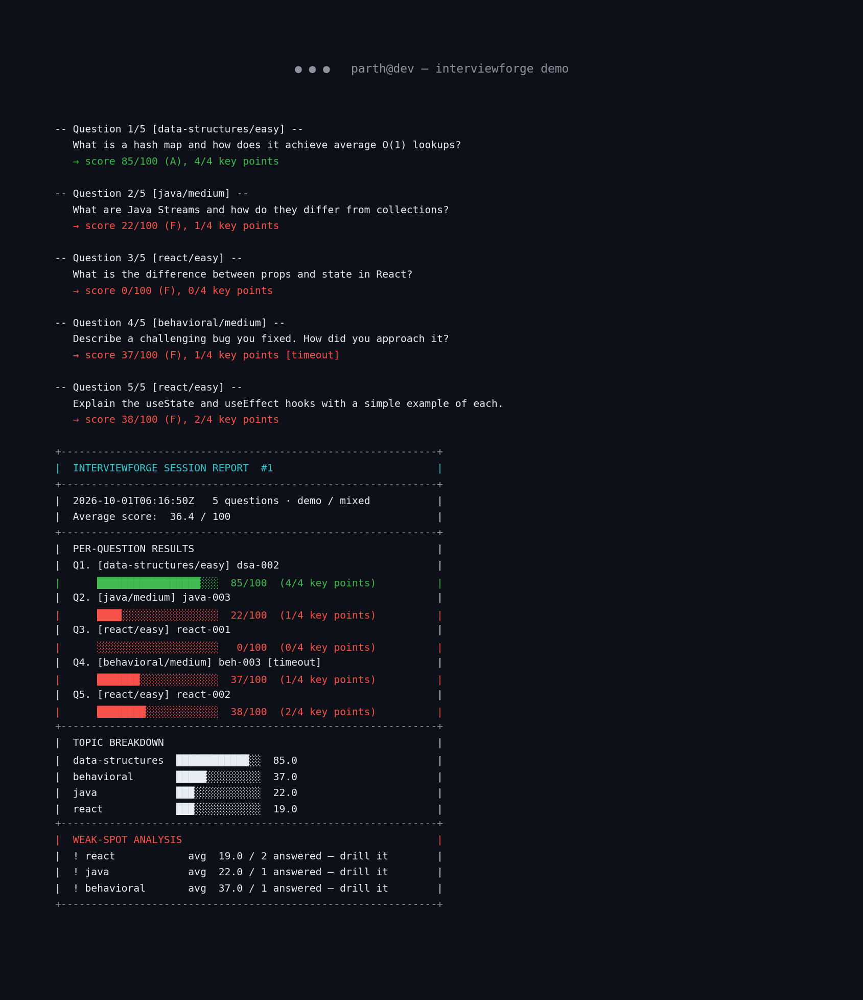

# InterviewForge

> **Walk into your next interview like you've already done it twenty times.** Timed mock interviews for software developers — with instant, transparent answer scoring and weak-spot tracking that tells you exactly what to drill next.

[](https://github.com/872000/interviewforge)
[](https://www.python.org/)
[](pyproject.toml)
[](LICENSE)

No accounts. No API keys. No network. Just you, a countdown timer, and honest feedback.


*Above: a real `interviewforge demo` run — scripted answers scored live, then a full session report with topic breakdown and weak-spot analysis.*

## ✨ Features

- 🗂️ **Curated question bank** — 28 questions across data structures, algorithms, Java, Spring Boot, React, and behavioral rounds. Every question is tagged by topic and difficulty and ships with model-answer key points.
- ⏱️ **Timed mock-interview CLI** — pick a topic, difficulty, and question count. Each question comes with a real countdown; run out of time and it costs you (just like the real thing).
- 🧠 **Heuristic answer scoring** — no LLMs, no API calls. Answers are scored against model-answer key points with a transparent rubric: key-concept coverage (70%), answer-length sanity (15%), and structure signals like examples and sequencing (15%). You always see *which* key points you missed.
- 🗄️ **SQLite progress tracking** — every session is stored with per-question scores. Watch your topic averages climb with `stats`, or browse past sessions with `history`.
- 📊 **Per-session reports** — a printable terminal report plus a saved Markdown file, with weakest-topic detection and trend arrows showing how each topic moved vs. your previous session.

## 🧮 How scoring works

| Component | Weight | What it measures |
|---|---|---|
| Key-concept coverage | 70% | Fraction of the model answer's key points your answer mentions (stemmed keyword matching, verbatim-phrase bonus) |
| Length sanity | 15% | One-liners are penalized; substantive answers are rewarded; rambling is capped |
| Structure signals | 15% | Explanations, examples, sequencing ("first… then…"), contrasts |

Timeouts cost 5 points and trigger a coaching tip ("give the headline answer first"). Grades run A (85+) → F (<40).

## 🛠️ Tech stack

- **Python 3.10+**, standard library only for the app itself (`argparse`, `sqlite3`, `json`, `dataclasses`) — zero install friction
- **SQLite** for session persistence (per-user DB under `~/.local/share/interviewforge/`, overridable via `INTERVIEWFORGE_DB`)
- **pytest** for the test suite (39 tests)
- **matplotlib** for the docs screenshot renderer only — never needed at runtime

## 🚀 Quickstart

```bash
git clone https://github.com/872000/interviewforge.git
cd interviewforge

# 1. See it in action — scripted demo, no input needed, ~10 seconds
python3 -m interviewforge demo

# 2. Run the test suite
python3 -m pytest -q

# 3. Do a real mock interview (Java, easy, 3 questions)
python3 -m interviewforge interview --topic java --difficulty easy -n 3

# 4. Review your progress
python3 -m interviewforge stats
python3 -m interviewforge history
python3 -m interviewforge report 1   # regenerate any session's report
```

*(Use `python` instead of `python3` if that's your interpreter.)*

### Question bank topics

| Topic | Questions | Covers |
|---|---|---|
| `data-structures` | 3 | Arrays vs linked lists, hash maps, stacks/queues |
| `algorithms` | 3 | Two pointers, quicksort, cycle detection |
| `java` | 6 | OOP, collections, streams, exceptions, GC, concurrency |
| `spring-boot` | 5 | DI/IoC, auto-configuration, REST, Spring Data JPA, Security |
| `react` | 5 | Props/state, hooks, virtual DOM, data fetching, memoization |
| `behavioral` | 6 | STAR-format answers: bug stories, conflict, weakness, projects |

Filter any interview: `python3 -m interviewforge interview --topic spring-boot --difficulty medium -n 5`

### Useful flags

```bash
python3 -m interviewforge interview --list-only -n 5 --seed 42   # preview the question set
python3 -m interviewforge interview --time-scale 0.2             # lightning round (20% time limits)
INTERVIEWFORGE_DB=/tmp/practice.db python3 -m interviewforge interview   # custom database
```

## 📁 Project structure

```
interviewforge/
├── interviewforge/
│   ├── __main__.py      # CLI: interview / demo / history / stats / report
│   ├── bank.py          # question-bank loading, validation, filtering
│   ├── data/
│   │   └── questions.json  # 28 tagged questions + model-answer key points
│   ├── demo.py          # scripted end-to-end demo (bundled demo data)
│   ├── report.py        # session reports, weak-spot analysis, trends
│   ├── scoring.py       # heuristic evaluation engine (no external APIs)
│   ├── session.py       # timed interactive question loop
│   ├── store.py         # SQLite persistence layer
│   └── terminal.py      # fixed-width terminal box helpers
├── tests/               # 39 pytest tests: bank, scoring, store, reports, e2e
├── docs/
│   ├── hero.png
│   ├── screenshot.png         # rendered from a REAL demo run
│   └── render_screenshot.py   # regenerates screenshot.png via matplotlib
├── pyproject.toml
├── LICENSE
└── README.md
```

## 🗺️ Roadmap

- [ ] Spaced-repetition mode: auto-schedule drills for your weakest topics
- [ ] Difficulty auto-tuning: harder questions as your averages climb
- [ ] Export progress charts (per-topic score trends over time)
- [ ] Community question packs (system design, SQL, behavioral) via JSON drop-in
- [ ] Voice mode: speak your answers, get transcribed and scored

## 📄 License

MIT — see [LICENSE](LICENSE). Copyright (c) 2026 Parth (872000).

---

*Built while job-hunting for entry-level Java/Spring Boot/React roles — because the best way to beat interview nerves is reps.* 💪
